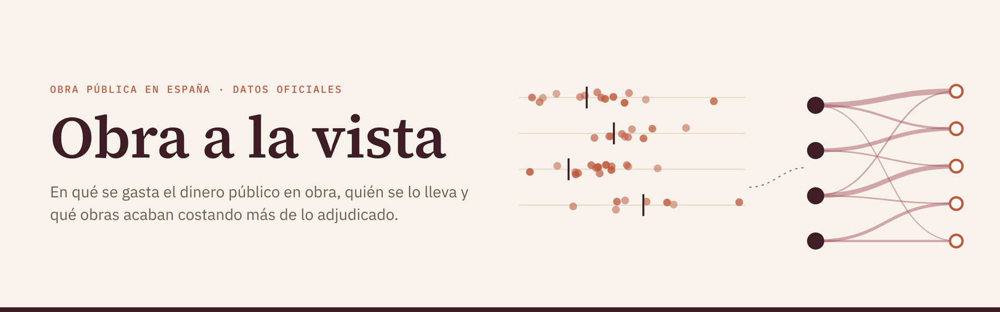
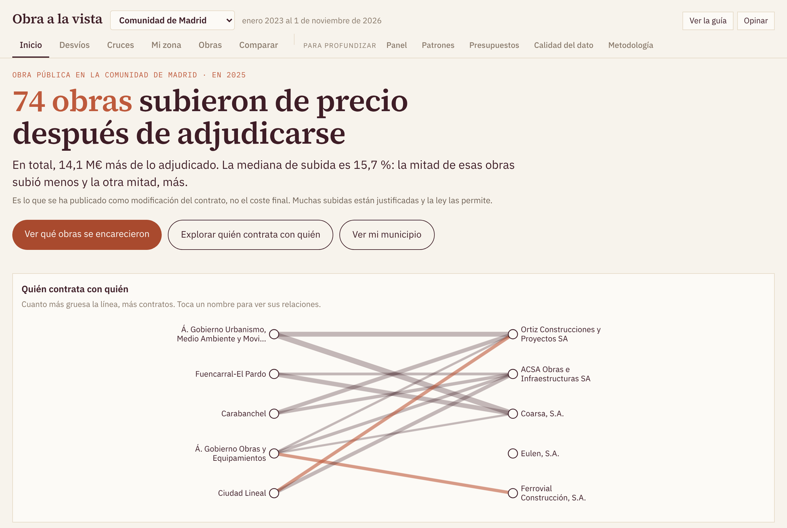
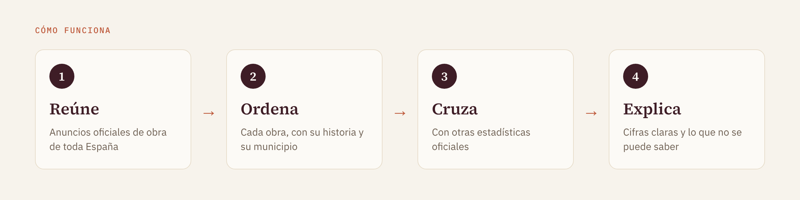
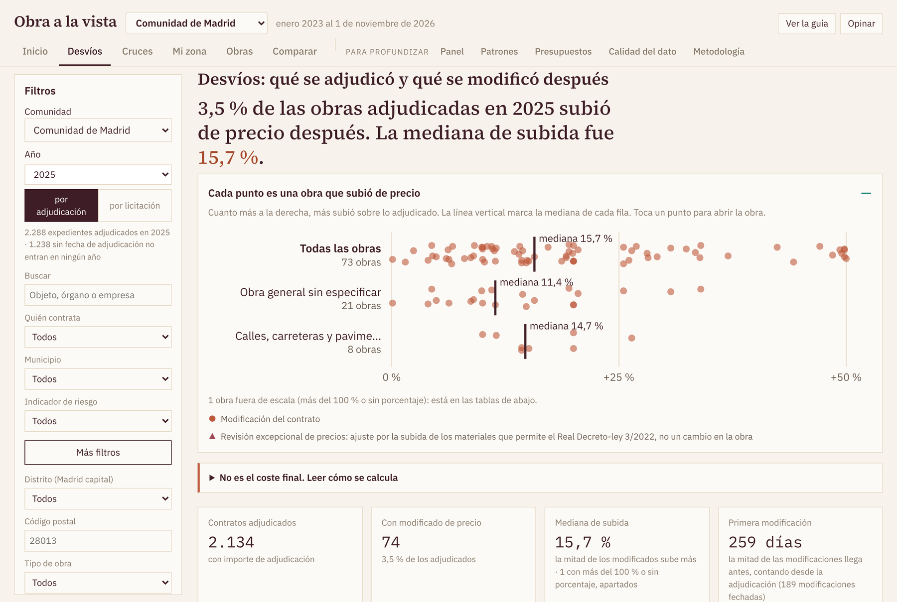
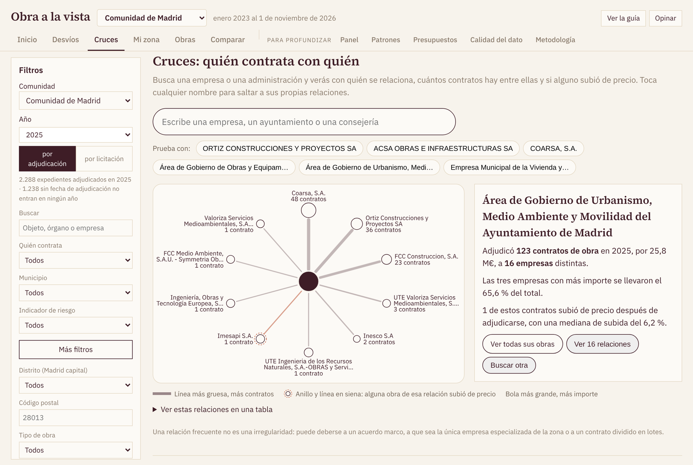
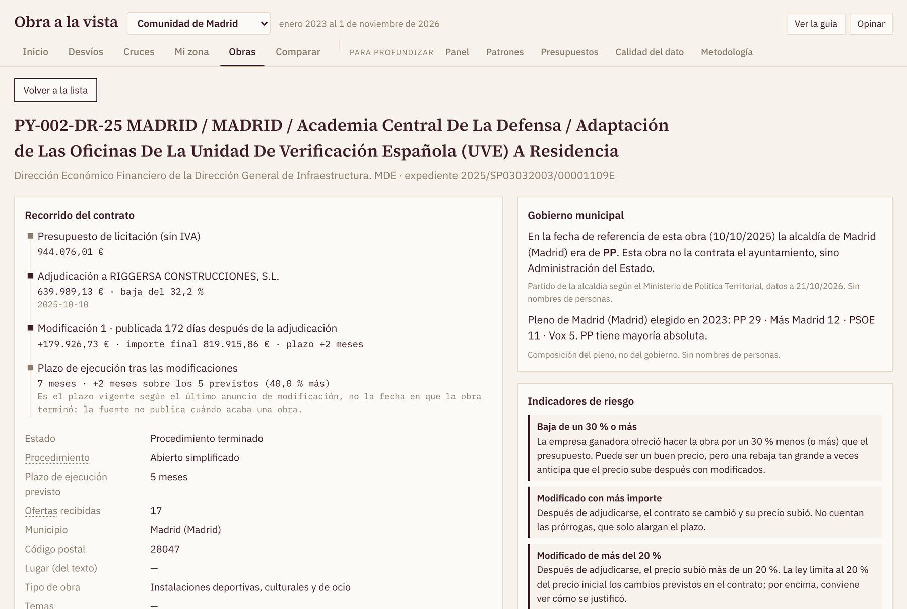
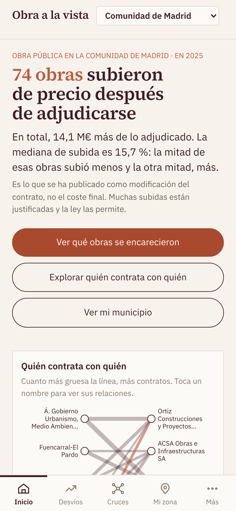

<a href="README.md">English</a> · <b>Español</b>

  

  
  
  
  

  <a href="https://obra-a-la-vista.obraalavista.workers.dev"><b>Abrir Obra a la vista →</b></a>

---

## El problema

Cada año las administraciones españolas adjudican miles de obras: colegios, carreteras, hospitales, aceras. Los datos son públicos, pero están repartidos en plataformas distintas, publicados en formatos pensados para máquinas, y nadie los junta. En la práctica, casi nadie puede responder preguntas sencillas como «¿qué obras de mi pueblo subieron de precio?» o «¿a qué empresas contrata siempre este ayuntamiento?».

**Obra a la vista reúne esos datos en una sola web, los explica en lenguaje claro y señala dónde merece la pena mirar**, siempre con el enlace al anuncio oficial.

> Toda la información sale de fuentes oficiales. Los indicadores señalan dónde mirar; no son acusaciones.

## Cómo funciona

1. **Reúne.** Los datos oficiales de contratación de obra pública de toda España.
2. **Ordena.** Cada obra, con su historia completa y su municipio.
3. **Cruza.** Con otras estadísticas oficiales, para comparar solo lo comparable.
4. **Explica.** Cifras que se entienden de un vistazo, con un aviso cada vez que un dato no permite concluir algo.

## Las ideas detrás

Unos pocos principios dan forma a cada pantalla:

- **Primero lo importante.** La portada abre con las obras que subieron de precio y con quién contrata con quién. Todo lo demás está un nivel más abajo, para quien quiera profundizar.
- **Cifras robustas.** Un desvío enorme no debe deformar la imagen, y las comparaciones llevan su margen de error.
- **Solo comparaciones justas.** Las comunidades cuyos datos llegan incompletos no se ordenan junto al resto, y un municipio solo se compara con otros de su tamaño.
- **Decir lo que no se sabe.** La fuente no publica cuándo termina una obra ni cuánto costó al final, así que la web nunca los presenta como si los tuviera.
- **Comprobado contra la fuente.** Una muestra aleatoria de obras se cotejó con su anuncio oficial, y las cifras coincidían.
- **Sin datos personales.** No se muestran nombres de personas, y las opiniones se guardan sin IP, sin nombre y sin correo.

## Qué hay dentro

| Sección | Qué te enseña |
| --- | --- |
| **Desvíos** | Las obras que subieron de precio después de adjudicarse, cuánto subieron y en qué tipo de obra pasa más |
| **Cruces** | Busca una empresa o una administración y ves sus relaciones, cuántos contratos hay entre ellas y si alguno subió de precio |
| **Mi zona** | La obra de tu municipio, contrate quien contrate |
| **Comparar** | Comunidades y municipios del mismo tamaño puestos al lado, solo con indicadores que significan lo mismo en todas partes |
| **Patrones** | Listas calculadas con las mismas reglas para todos: empresas que se llevan casi todo lo de un órgano, obras con un único licitador, contratos menores justo por debajo del límite legal |
| **Sobre los datos** | De dónde sale cada cifra, qué obliga la ley a publicar, qué no se puede saber y qué falta en lo que publica cada administración |

Cada obra tiene su ficha: presupuesto, adjudicación, empresa, número de ofertas, plazo de ejecución previsto, modificaciones y el enlace al anuncio oficial.

**En cifras:** 171.000 expedientes de obra de enero de 2023 a noviembre de 2026, 132.000 obras adjudicadas, más de 13.000 órganos de contratación, 39.000 empresas y 10.400 obras modificadas después de adjudicarse.

## Cómo está hecho

| Capa | Tecnología |
| --- | --- |
| Procesamiento de datos | Python |
| Web | HTML, CSS y JavaScript sin frameworks, con gráficos SVG propios, carga por años y versión móvil |
| Publicación | **Cloudflare Workers**: los ficheros se sirven desde la red de Cloudflare y un Worker en Python con FastAPI recibe las opiniones |
| Base de datos | Postgres en Neon a través de Cloudflare Hyperdrive |
| Protección contra bots | **Cloudflare Turnstile** en el formulario de opiniones |

## Estado

En marcha y con toda España. Los datos se actualizan desde las fuentes oficiales, y la página «Sobre los datos» de la web explica de dónde sale cada cifra y cada limitación conocida.

---

## Sobre mí

  <a href="https://www.linkedin.com/in/yael-parra/">
    
    &nbsp;
    
  </a>

Soy consultora de IA y construyo producto. Trabajo en los dos lados: ayudo a las empresas a adoptar la IA y construyo las herramientas.

Obra a la vista es un proyecto ciudadano e independiente. Lo diseñé de principio a fin: el flujo de datos, las reglas de cada indicador, la experiencia y el despliegue.

Si trabajas en algo que cruce datos, IA e interés público y quieres hablar, me encuentras en [linkedin.com/in/yael-parra](https://www.linkedin.com/in/yael-parra/).

Los datos pertenecen a las administraciones que los publican; Obra a la vista solo los reúne y los explica.
