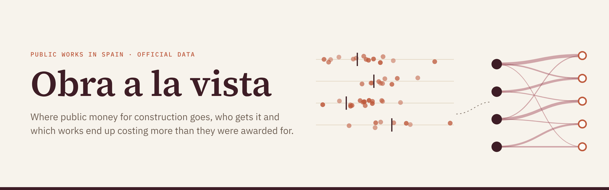
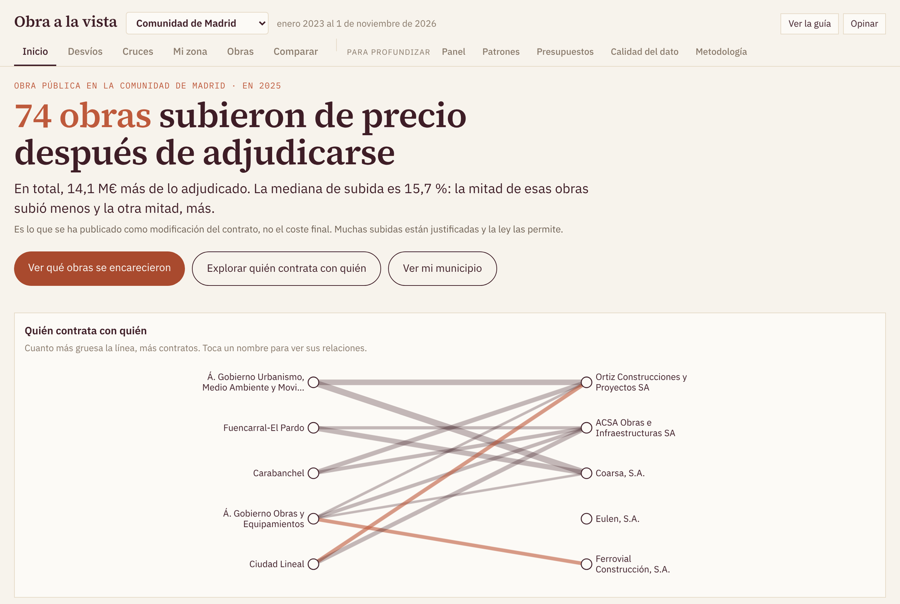
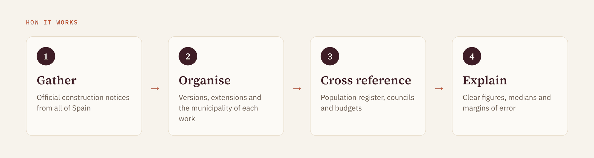
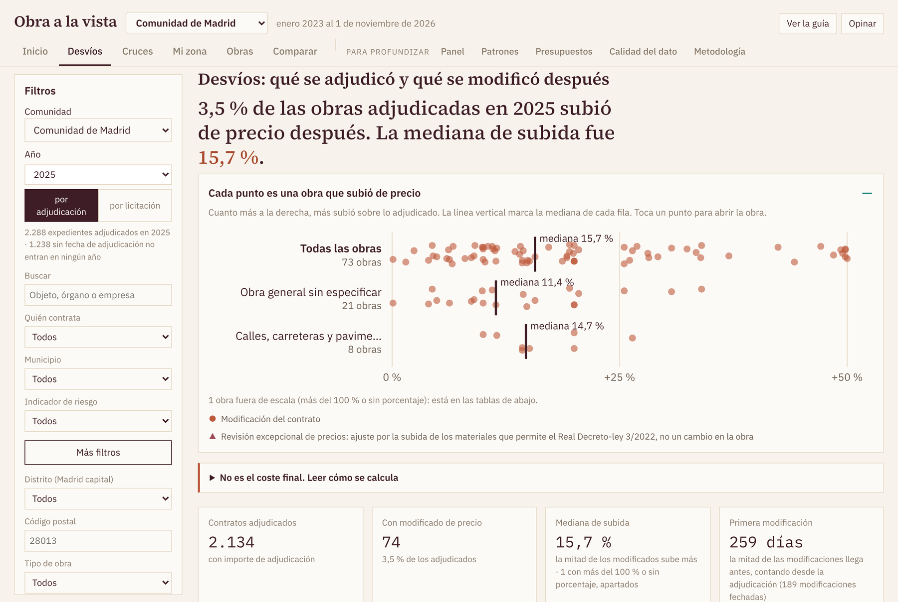
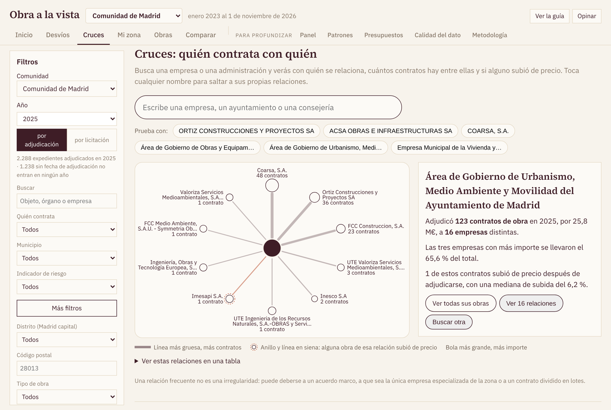
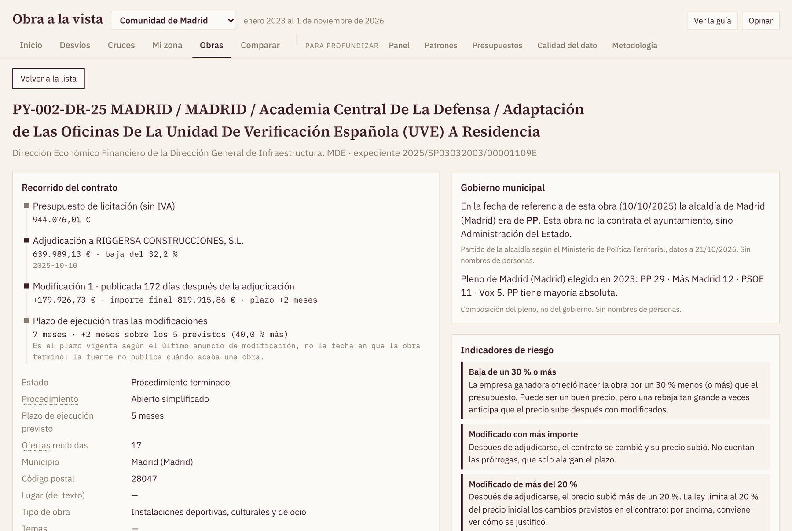
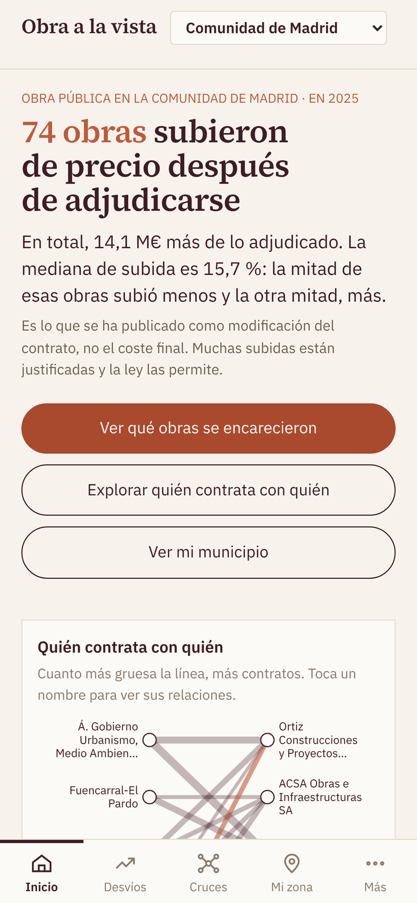

<b>English</b> · <a href="README.es.md">Español</a>

  

  
  
  
  

  <a href="https://obra-a-la-vista.obraalavista.workers.dev"><b>Open Obra a la vista →</b></a>

---

## The problem

Every year Spanish public administrations award thousands of construction contracts: schools, roads, hospitals, pavements. The data is public, but it is scattered across different platforms, published in formats designed for machines, and nobody puts it together. In practice, almost no one can answer simple questions such as "which works in my town went up in price?" or "which companies does this council always hire?".

**Obra a la vista** ("public works in plain sight") **gathers that data in a single website, explains it in plain language and points out where it is worth taking a closer look**, always linking back to the official notice.

> The website is in Spanish. All the information comes from official sources. The indicators point to where to look; they are not accusations.

## How it works

1. **Gather.** Construction notices are downloaded from Spain's Public Sector Procurement Platform, which also collects what the regional platforms publish.
2. **Organise.** Every version of each case file is merged, time extensions are separated from price modifications and each work is placed in its municipality.
3. **Cross reference.** The national population register is added to compare municipalities of similar size and, in the Community of Madrid, town councils, mayors and municipal budgets.
4. **Explain.** Everything becomes figures that can be read at a glance, with a warning whenever the data does not support a conclusion.

## The thinking behind it

A few principles shape every screen:

- **Lead with what matters.** The home page opens with the works that went up in price and who contracts with whom. Everything else is one level deeper, for those who want it.
- **Medians, not averages.** A single huge overrun should not distort the picture, so the typical figure is always the median, and comparisons carry their margin of error.
- **Fair comparisons only.** Regions are not ranked against each other when their data reaches the national platform through different channels, and municipalities are only compared with others of the same size.
- **Say what is not known.** The source does not publish when a work is finished or what it finally cost, so the website never presents those as if it had them.
- **Checked against the source.** Out of 180 randomly chosen works, 10 per region, 175 were compared by hand with their official page, and the budget matched in all of them.
- **No personal data.** No names of people are shown, and feedback is stored without IP address, name or email.

## What's inside

| Section | What it shows |
| --- | --- |
| **Desvíos** (cost overruns) | Works whose price went up after being awarded, by how much, and in which type of work it happens most |
| **Cruces** (who contracts with whom) | Search for a company or an administration and see its relationships, how many contracts link them and whether any went up in price |
| **Mi zona** (my area) | Construction in your municipality, whoever the contracting authority is |
| **Comparar** (compare) | Regions and similarly sized municipalities side by side, only with indicators that mean the same everywhere |
| **Patrones** (patterns) | Lists built with fixed rules applied equally to everyone: companies that take almost all of one authority's work, single bidder contracts, minor contracts just below the legal threshold |
| **Calidad del dato** (data quality) | What is missing or inconsistent in what each administration publishes, and which authorities publish the most complete records |

Every work has its own page: budget, award, company, number of bids, planned execution period, modifications and the link to the official notice.

**In figures:** 171,000 construction case files from January 2023 to November 2026, 132,000 awarded works, more than 13,000 contracting authorities, 39,000 companies and 10,400 works modified after being awarded.

## How it is built

| Layer | Technology |
| --- | --- |
| Ingestion and cleaning | Python: parsing of the national platform's ATOM and CODICE files, with scheduled GitHub Actions |
| Website | HTML, CSS and JavaScript without frameworks, custom SVG charts, loading by year and a mobile version |
| Hosting | **Cloudflare Workers**: files are served from Cloudflare's network and a Python Worker with FastAPI receives feedback |
| Database | Postgres on Neon through Cloudflare Hyperdrive, with a user that can only insert |
| Bot protection | **Cloudflare Turnstile** on the feedback form, plus a honeypot field and a per IP submission limit |

## Status

Live and covering all of Spain. Data is refreshed from the official sources, and the methodology page on the website explains every rule and every known limitation.

---

## About me

  <a href="https://www.linkedin.com/in/yael-parra/">
    
    &nbsp;
    
  </a>

I'm an AI consultant and product builder. I work on both sides: helping companies adopt AI and building the tools myself.

Obra a la vista is an independent civic project. I designed it end to end: the data pipeline, the rules behind every indicator, the experience and the deployment.

If you're working on something at the intersection of data, AI and public interest and want to talk, find me at [linkedin.com/in/yael-parra](https://www.linkedin.com/in/yael-parra/).

The data belongs to the administrations that publish it; Obra a la vista only gathers and explains it.
